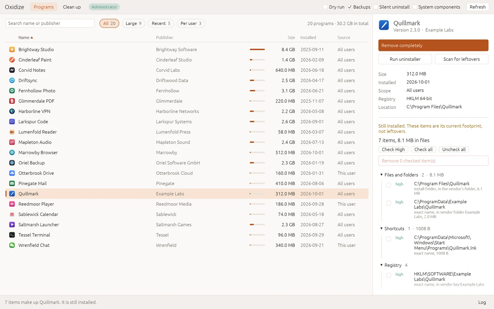

# Oxidize

Oxidize uninstalls Windows programs and removes what they leave behind.

<picture>
  <source media="(prefers-color-scheme: dark)" srcset="site/img/hero-dark-1440.webp">
  
</picture>

[Download Oxidize](https://portfolio-izanagi.vercel.app/projects/oxidize), then double-click it.

The file is not signed, so Windows may say "Windows protected your PC"; click More info, then Run anyway.

There is nothing to install. The command-line version and a zip with both are
under [Other ways to install](docs/install.md).

To update, download the file again and replace the old one. Every release uses
the same file names, so the links here always get the latest version.
The latest version is 0.2.22; [CHANGELOG.md](CHANGELOG.md) lists what each
release changed.

## What it does

Windows' own uninstall leaves things around: registry keys, folders under
AppData and ProgramData, settings in the user's folder, services, scheduled
tasks, firewall rules, PATH entries that point nowhere. Oxidize closes whatever still runs from the
program's folders, runs its uninstaller when one is needed, then finds those
leftovers and removes them. A second scan ends the run with `Nothing left.` or
a list of what is still there and why. A removal is permanent unless you ask
for a backup: with `--backup`, or Back up before deleting turned on in the
window, everything removed is backed up first and can be put back with one
command.

In the window, select a program and click Remove completely; with a backup,
Undo puts back what was removed. From a terminal it is one command:

```
oxidize uninstall "Example Player" --yes
```

```
oxidize list                     installed programs and Store apps
oxidize uninstall <program>      uninstall, then remove the leftovers
oxidize scan <program>           leftovers of a program, installed or not
oxidize orphans                  folders and references nothing owns anymore
oxidize trace <exe or process>   which program does this belong to
oxidize backups                  what earlier removals backed up
oxidize restore <backup>         put a backup back
oxidize clean                    temp files, crash dumps, caches, folders of removed programs
oxidize clean --traces           recent items, jump lists, histories: a clean slate
oxidize protect --check <path>   is this path kept out of every clean
oxidize mcp                      let an AI assistant use Oxidize
```

`oxidize-gui.exe` is the same engine as a window.

## Clean up

`oxidize clean` looks at what piles up on a PC and changes nothing: temporary
files, crash dumps and error reports, the Recycle Bin, browser caches, the
stores Windows cleans with its own tools, and folders of programs that are
gone. Every size is counted from the files themselves. For each category it
says what would go and what stays, and why: changed in the last 7 days, in
use by a running program, protected, needs administrator rights, the browser
is running. `oxidize clean --yes` then cleans the safe set, which is
temporary files, crash dumps, browser caches and folders of removed programs
at high confidence. Every file is checked again right before it goes, and
the run ends with what was freed per category and what stayed.

```
oxidize clean                         what would go, nothing changes
oxidize clean --yes                   clean the safe set
oxidize clean --recycle-bin --yes     only Recycle Bin items deleted 30 or more days ago
```

More in [docs/clean-up.md](docs/clean-up.md).

## Use it with an AI assistant

`oxidize mcp` runs an MCP (Model Context Protocol) server for an assistant on
your PC. It talks to the assistant over stdin and stdout, nothing else, and
runs only while the assistant has it open. It takes no `--dry-run`, `--yes` or
`--backup`: the assistant previews with `plan_removal`, and a plan keeps a
backup only when it is made with one. Add it to the assistant's MCP settings with the full
path to `oxidize.exe`:

```json
{
  "mcpServers": {
    "oxidize": {
      "command": "C:\\Tools\\oxidize.exe",
      "args": ["mcp"]
    }
  }
}
```

More in [docs/mcp.md](docs/mcp.md).

## Build from source

You need Git, Rust 1.95 or newer and the Visual Studio Build Tools with the
Windows SDK. The Build Tools provide the MSVC linker; the SDK provides
`rc.exe`, which `build.rs` needs to embed the icon. On a fresh PC, install them
from PowerShell:

```
winget install --id Git.Git -e
winget install --id Rustlang.Rustup -e
winget install --id Microsoft.VisualStudio.2022.BuildTools -e --override "--wait --passive --add Microsoft.VisualStudio.Workload.VCTools --add Microsoft.VisualStudio.Component.VC.Tools.x86.x64 --add Microsoft.VisualStudio.Component.Windows11SDK.26100"
```

Open a new terminal so PATH picks up the new tools, then build:

```
rustup default stable
git clone https://github.com/dominikkoenitzer/Oxidize.git
cd Oxidize
cargo build --release --locked
```

The programs end up in `target\release\oxidize.exe` and
`target\release\oxidize-gui.exe`. Both are self-contained: the C runtime is
linked in, so they run on any Windows PC without installing a runtime.

Once you have the clone, `scripts\setup.ps1` does the checking for you. It
looks for rustup, cargo, the MSVC build tools and the Windows SDK and prints
the winget command for anything missing; it installs nothing itself. When
nothing is missing it runs `cargo build --release --locked`. From the
repository root:

```
powershell -ExecutionPolicy Bypass -File scripts\setup.ps1
```

Before you send a change, run what CI runs:

```
cargo test --locked
cargo clippy --locked --all-targets -- -D warnings
cargo fmt --check
```

The engine is a library (`src/lib.rs`); `src/main.rs` and
`src/bin/oxidize-gui.rs` are the two front-ends. Leftovers are only ever
deleted through `safety::remove_leftovers`, the folders of removed programs
that `oxidize clean` finds included. Two other paths delete: the Store-app
removal in `packages.rs`, which Windows carries out and which runs only after
the guard allows it, and the rest of `src/clean`, which deletes temporary
files, crash dumps, browser caches and Recycle Bin items directly, each
checked again right before it goes, and clears Windows' lists of recent use
for `--traces`. None of those can be put back. The MCP server in `src/mcp.rs`
reads through one trait and removes through another, `Remove`, implemented in
`src/mcp/machine.rs`, which only `apply_removal_plan` holds.

## Docs

- [docs/cli.md](docs/cli.md): every command and flag, exit codes, JSON output and what gets checked
- [docs/clean-up.md](docs/clean-up.md): every clean up category and what stays
- [docs/mcp.md](docs/mcp.md): what an AI assistant can and cannot do
- [docs/install.md](docs/install.md): other ways to install, your data, backups and removal

## Contributing

See [CONTRIBUTING.md](CONTRIBUTING.md). Report security issues privately as
described in [SECURITY.md](SECURITY.md). Changes are listed in
[CHANGELOG.md](CHANGELOG.md).

## License

MIT, see [LICENSE](LICENSE).
